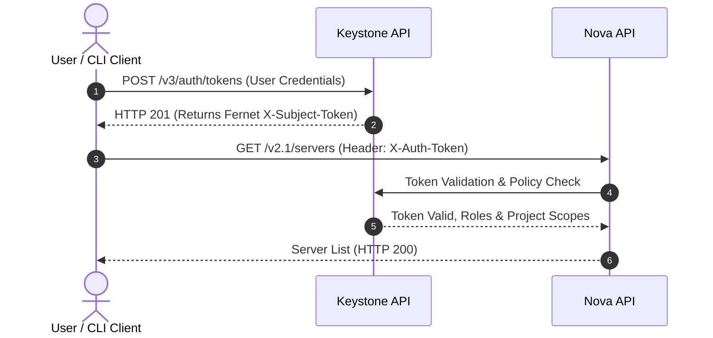

# Keystone: Identity Service Architecture

Keystone menangani autentikasi, otorisasi, dan service discovery di OpenStack. Setiap request ke Nova, Neutron, Glance, dan Cinder divalidasi lewat Keystone

## 1. Arsitektur Fernet Token

OpenStack modern meninggalkan token UUID dan PKI karena UUID butuh lookup database terus-menerus dan PKI ukuran header HTTP-nya terlalu besar. Penggantinya adalah Fernet Token

- Ukuran ringkas sekitar 255 karakter, memakai enkripsi simetris AES-128-CBC dengan autentikasi HMAC-SHA256
- Validasi bersifat stateless karena Keystone tidak menyimpan token aktif di MySQL; verifikasi dihitung dari symmetric key di /etc/keystone/fernet-keys/
- Rotasi key dilakukan berkala dengan perintah keystone-manage fernet_rotate

## 2. RBAC Policy Scoping

Pembagian scope token untuk mencegah privilege escalation

| Token Scope | Batas Akses | Contoh Kemampuan |
|---|---|---|
| System-Scoped | Infrastruktur fisik global | Manajemen hypervisor, binding network provider global, inspeksi log control-plane |
| Domain-Scoped | Batas administratif tenant/organisasi | Lifecycle user, keanggotaan group, alokasi quota project |
| Project-Scoped | Batas resource per project | Buat instance, attach virtual port, update security group |

## 3. Service Catalog dan Service Tokens

Service Catalog berfungsi sebagai direktori endpoint REST API untuk semua komponen

- Public Endpoint: diakses oleh client eksternal dan end user
- Internal Endpoint: jalur komunikasi antar-service di subnet management
- Admin Endpoint: dipakai untuk workflow administratif khusus

Untuk mencegah token kedaluwarsa saat task berjalan lama, Service Token (X-Service-Token) dikirim berbarengan dengan user token (X-Auth-Token) ketika Nova berkomunikasi ke Glance atau Neutron

  <a class="page-nav-btn" href="{{ '/docs/overview/environment-setup/' | relative_url }}">&larr; Environment & Setup</a>
  <a class="page-nav-btn" href="{{ '/docs/core-services/nova-placement/' | relative_url }}">Next: Nova & Placement &rarr;</a>

