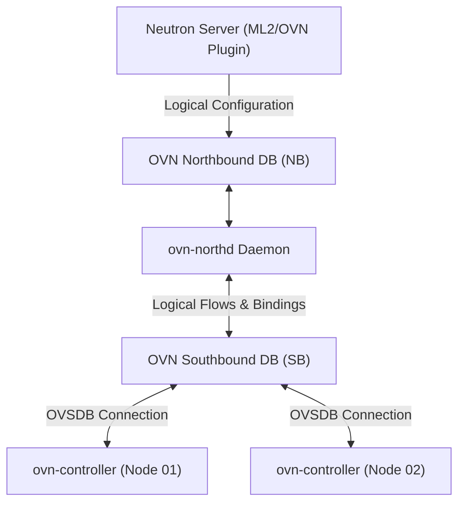

# Neutron: Software-Defined Networking with OVN

Neutron menyediakan layer software-defined networking untuk VM. Pada rilis OpenStack modern (2024 sampai 2026), Open Virtual Network (OVN) menjadi mechanism driver standar menggantikan arsitektur agen ML2/OVS lama

## 1. OVN vs Legacy ML2/OVS

Arsitektur OVS lama butuh beberapa daemon Python terpisah di tiap compute node (neutron-openvswitch-agent, neutron-dhcp-agent, neutron-l3-agent, neutron-metadata-agent) sehingga boros memory dan lambat saat konvergensi flow

Keunggulan OVN
- Cukup satu daemon C ringan (ovn-controller) di tiap node yang menangani L2 switching, L3 distributed routing, DHCP, dan metadata langsung di Open vSwitch
- Memakai dua database OVSDB: Northbound DB (NB DB) untuk konfigurasi logis dari Neutron, dan Southbound DB (SB DB) untuk binding fisik dan flow
- Memakai enkapsulasi Geneve yang mendukung opsi metadata TLV lebih fleksibel dibanding VXLAN biasa

## 2. Distributed Virtual Routing (DVR) dan Floating IP

- Routing antar network private tenant (east-west traffic) diproses lokal di host tempat VM sumber berada tanpa lewat gateway terpusat
- Untuk akses keluar (north-south traffic), VM tanpa Floating IP memakai SNAT terpusat lewat gateway chassis
- VM yang punya Floating IP memakai 1:1 NAT terdistribusi langsung di hypervisor tempat VM berjalan

## 3. Konfigurasi Bridge Single NIC

Pada node dengan satu interface fisik (ens3), bridge eksternal br-ex di-binding langsung ke ens3

    sudo ovs-vsctl show
    sudo ovs-vsctl add-port br-ex ens3

Aktifkan forwarding paket dan matikan rp_filter di kernel supaya traffic bridge bisa lewat

    sudo sysctl -w net.ipv4.ip_forward=1
    sudo sysctl -w net.ipv4.conf.all.rp_filter=0
    sudo sysctl -w net.ipv4.conf.default.rp_filter=0

  <a class="page-nav-btn" href="{{ '/docs/core-services/nova-placement/' | relative_url }}">&larr; Nova & Placement</a>
  <a class="page-nav-btn" href="{{ '/docs/core-services/storage/' | relative_url }}">Next: Glance & Cinder &rarr;</a>

