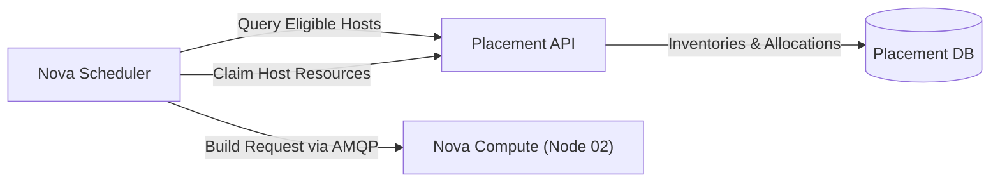

# Nova: Compute Orchestration & Placement API

Nova mengatur siklus hidup instance mulai dari scheduling, provisioning, resize, sampai penghapusan VM di node hypervisor

## 1. Placement API dan Inventory Modeling

Placement API mencatat kapasitas dan alokasi resource compute supaya Nova Scheduler tidak perlu polling langsung ke tiap hypervisor

- Resource Provider (RP): entitas penyedia kapasitas seperti host hypervisor ab-lab-research-02
- Inventory: kapasitas kuantitatif milik RP seperti VCPU, MEMORY_MB, dan DISK_GB
- Traits: kapabilitas kualitatif pada RP misalnya HW_CPU_X86_AVX2 atau CUSTOM_NVME
- Allocations: resource yang sudah direservasi oleh instance aktif

## 2. Alur Boot Instance

Saat menjalankan openstack server create, urutannya berjalan seperti berikut

- Nova API memvalidasi token via Keystone, mengecek quota, lalu membuat record database berstatus BUILDING
- Nova Conductor mengoordinasikan request scheduling tanpa memberi akses database langsung ke compute node
- Nova Scheduler mengecek Placement API untuk mencari Resource Provider yang memenuhi flavor lalu memilih host lewat weigher (RAM/CPU)
- Nova Conductor mengirim pesan AMQP lewat RabbitMQ ke nova-compute di Node 2
- nova-compute meminta alokasi virtual port dan IP ke Neutron, lalu menarik base image dari Glance ke /opt/stack/data/nova/instances/_base
- Libvirt driver membuat XML domain dan menyalakan proses KVM

## 3. Tuning Alokasi Memory di Homelab 4GB

Di node dengan RAM terbatas, parameter overcommit pada nova.conf wajib dibatasi supaya host tidak terkena OOM killer

    [DEFAULT]
    cpu_allocation_ratio = 4.0
    ram_allocation_ratio = 1.0
    reserved_host_memory_mb = 1024

- Menjaga ram_allocation_ratio = 1.0 mencegah over-alokasi RAM fisik oleh VM dan menyisakan 1024 MB untuk daemon sistem serta Open vSwitch

  <a class="page-nav-btn" href="{{ '/docs/core-services/keystone/' | relative_url }}">&larr; Keystone (Identity)</a>
  <a class="page-nav-btn" href="{{ '/docs/core-services/neutron-ovn/' | relative_url }}">Next: Neutron & OVN &rarr;</a>

