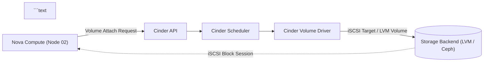

# Storage Services: Glance & Cinder

OpenStack membagi storage menjadi dua service utama: Glance untuk katalog OS image VM, dan Cinder untuk block volume persisten yang bisa di-attach ke instance

## 1. Glance: Image Registry

Glance menyimpan OS image, template cloud-init, dan ISO installer beserta metadatanya

Perbandingan format image RAW vs QCOW2

| Aspek | QCOW2 | RAW |
|---|---|---|
| Efisiensi Storage | Sparse dan terkompresi, hemat ruang disk awal | Alokasi penuh sesuai ukuran virtual disk |
| Kecepatan Boot Awal | Lebih lambat karena Nova harus unpack atau buat overlay | Paling cepat karena langsung sparse clone |
| Performa I/O | Ada sedikit overhead translasi saat blok bertambah | Performa native mendekati disk fisik |
| Kecocokan Ceph RBD | Kurang optimal, perlu konversi ke RAW untuk fast clone | Wajib untuk copy-on-write instan di Ceph |

Upload image CirrOS ringan untuk tes boot instance

```text
openstack image create "cirros-0.6.2" \
  --file cirros-0.6.2-x86_64-disk.img \
  --disk-format qcow2 \
  --container-format bare \
  --public
```

## 2. Cinder: Persistent Block Storage

Disk ephemeral bawaan Nova akan hilang saat instance dihapus, sedangkan volume Cinder tetap persisten secara terpisah

- cinder-api: memvalidasi dan meneruskan request manajemen volume dari user dan Nova
- cinder-scheduler: memilih backend storage sesuai ukuran, tipe volume, IOPS, dan availability zone
- cinder-volume: berkomunikasi langsung dengan driver storage fisik (Ceph RBD, LVM/iSCSI, NFS, atau SAN)


```

## 3. Implementasi LVM Loopback di Homelab

Di lab DevStack terbatas, Cinder memakai loopback file yang dijadikan volume group LVM bernama stack-volumes-default

Cek pool LVM aktif lalu buat dan attach volume tes berukuran 5 GB

```bash
sudo vgs
sudo lvs
```

```text
VG                    #PV #LV #SN Attr   VSize  VFree
stack-volumes-default   1   0   0 wz--n- 24.00g 24.00g
```

```bash
openstack volume create --size 5 test-volume-01
openstack server add volume my-instance test-volume-01
```

<div class="page-nav-box">
  <a class="page-nav-btn" href="{{ '/docs/core-services/neutron-ovn/' | relative_url }}">&larr; Neutron & OVN</a>
  <a class="page-nav-btn" href="{{ '/docs/operations/troubleshooting/' | relative_url }}">Next: Troubleshooting &rarr;</a>
</div>
