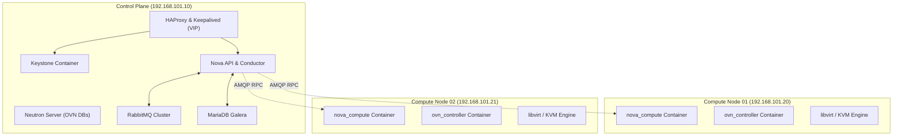

# Kolla-Ansible Multi-Node Deployment Guide

Panduan deploy OpenStack berbasis container dengan Kolla-Ansible. Berbeda dari DevStack yang cocok untuk development, Kolla-Ansible membungkus tiap daemon ke container Docker atau Podman yang diorkestrasi lewat Ansible

## DevStack vs Kolla-Ansible

| Aspek | DevStack | Kolla-Ansible |
|---|---|---|
| Target | Core developer dan feature testing | Production cluster, staging lab, operator |
| Model Eksekusi | Daemon systemd di Python virtualenv | Microservices container (Docker / Podman) |
| Strategi Upgrade | Sulit, harus wipe dan re-stack | Rolling update image container |
| High Availability | Single-node atau dev 2-node manual | HA native dengan Keepalived, HAProxy, dan MariaDB Galera |
| Konfigurasi | Satu file local.conf | YAML terstruktur di /etc/kolla/globals.yml |

Tiap daemon berjalan di container terpisah (misalnya nova_api, nova_conductor, neutron_server) dengan file konfigurasi hasil generate Jinja2 yang di-mount dari /etc/kolla/

## Arsitektur Lab & Inventory

Contoh file inventory multinode

    [control]
    control01 ansible_host=192.168.101.10 ansible_user=ubuntu

    [network:children]
    control

    [compute]
    compute01 ansible_host=192.168.101.20 ansible_user=ubuntu
    compute02 ansible_host=192.168.101.21 ansible_user=ubuntu

    [storage:children]
    control

    [monitoring:children]
    control

    [deployment]
    localhost ansible_connection=local

## Konfigurasi Utama (/etc/kolla/globals.yml)

Pastikan kolla_internal_vip_address tidak bentrok dengan IP statis atau DHCP di subnet management karena Keepalived akan mengikat VIP tersebut lewat VRRP

    ---
    openstack_release: "2024.1"
    kolla_base_distro: "ubuntu"
    kolla_install_type: "source"

    network_interface: "ens3"
    neutron_external_interface: "ens4"
    kolla_internal_vip_address: "192.168.101.250"

    neutron_plugin_agent: "ovn"
    neutron_ovn_distributed_floating_ip: "yes"

    enable_openstack_core: "yes"
    enable_horizon: "yes"
    enable_cinder: "yes"
    enable_cinder_backend_lvm: "yes"
    enable_central_logging: "no"

## Tahapan Deploy

Jalankan berurutan dari host deployment untuk bootstrap dependensi, prechecks, deploy container, lalu generate kredensial admin-openrc.sh

    kolla-ansible -i multinode bootstrap-servers
    kolla-ansible -i multinode prechecks
    kolla-ansible -i multinode deploy
    kolla-ansible -i multinode post-deploy

Source kredensial hasil deploy dan verifikasi endpoint serta daftar hypervisor

    source /etc/kolla/admin-openrc.sh
    openstack endpoint list
    openstack hypervisor list

## Diagnosa Container

Cek status container Kolla, pantau log live, masuk ke shell container, atau baca konfigurasi yang ter-mount di node

    docker ps --format "table {{.Names}}\t{{.Status}}\t{{.Image}}"
    docker logs -f nova_compute
    docker exec -it nova_compute bash
    cat /etc/kolla/nova-compute/nova.conf

  <a href="{{ '/docs/operations/troubleshooting/' | relative_url }}" class="page-nav-btn">&larr; Troubleshooting & Diagnostics</a>
  <a href="{{ '/labs/' | relative_url }}" class="page-nav-btn">Lab Scripts & Configs &rarr;</a>

