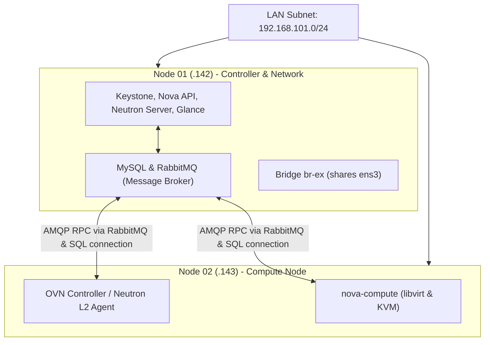

# OpenStack DevStack Architecture & Lab Topology

Dokumentasi arsitektur lab multi-node DevStack di atas resource terbatas: dua VM Ubuntu 24.04 LTS dengan masing-masing 4GB RAM dan disk 60GB

## Batasan Lab

Panduan OpenStack umumnya mengasumsikan RAM 16GB sampai 32GB per node. Menjalankan cluster multi-node di VM 4GB memaksa kita memahami konsumsi memory tiap daemon dan cara kerjanya, terutama untuk menjaga agar systemd-oomd tidak mematikan mysqld atau beam.smp (RabbitMQ)

## Topologi Node dan Pembagian Role

Lab berjalan di dua node dalam satu subnet LAN yang sama

| Node | Hostname | IP Address | Role & Daemon |
|---|---|---|---|
| Node 1 | ab-lab-research-01 | 192.168.101.142 | Controller & Network Node: Keystone, Nova API, Nova Conductor, Nova Scheduler, Glance, Neutron Server, MySQL, RabbitMQ, OVN Central |
| Node 2 | ab-lab-research-02 | 192.168.101.143 | Compute Node: nova-compute, libvirt, KVM, ovn-controller |

## Alur Kontrol dan Komunikasi

- Node 2 tidak melakukan scheduling sendiri; keputusan penempatan VM sepenuhnya dikerjakan Node 1 lewat Nova Scheduler dan Placement API, lalu Node 2 mengeksekusi lewat libvirt/KVM
- Tidak ada koneksi SSH antar node saat provisioning instance; koordinasi berjalan lewat RabbitMQ (AMQP) dan koneksi langsung ke MySQL
- Seluruh service API dan database dikonsolidasikan di Node 1 supaya Node 2 fokus ke proses hypervisor dan VM user

## Konfigurasi External Network Single NIC

Karena tiap VM hanya punya satu interface fisik (ens3), external bridge Open vSwitch br-ex menumpang di interface yang sama

- Bridge br-ex dipasang langsung ke ens3
- Blok IP /28 yang kosong di subnet LAN dialokasikan untuk pool Floating IP OpenStack
- Konfigurasi DevStack memakai PUBLIC_INTERFACE=ens3 dan FLOATING_RANGE mengarah ke blok subnet tersebut

  <a class="page-nav-btn" href="{{ '/' | relative_url }}">&larr; Introduction</a>
  <a class="page-nav-btn" href="{{ '/docs/overview/environment-setup/' | relative_url }}">Next: Environment & Setup &rarr;</a>

